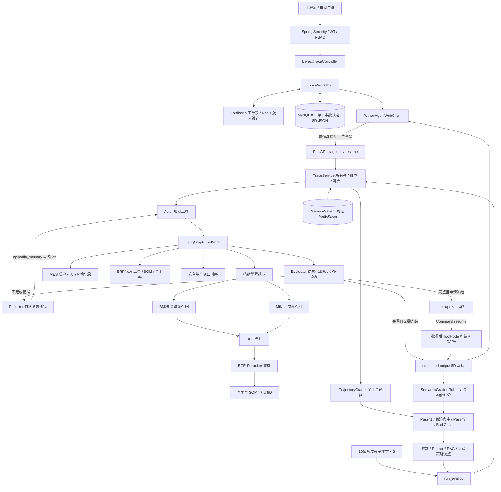

# 不良品根因追溯：终极 1 小时学习与面试指南

先记住项目主线：**Java 管工单与授权，Python 图管诊断过程，工具提供证据，评测检查是否可靠完成。** 一次温度异常只能形成假设，不能替代物料排查、型号标准对照和现场验证。

这份指南对应本目录真实实现。旧 AgentScope 系统没有被修改；这是独立的异构 MVP。默认模式使用真实 LangGraph、ToolNode、interrupt，模型/ERP/检索后端为合成 Mock。带 Key 的模型路径、RedisSaver 和 Milvus/BGE 适配入口已写入，但不能把入口代码说成生产联调成果。来源见 [SOURCES.md](SOURCES.md)，运行入口见 [README.md](README.md)。

学习安排：架构 5 分钟 → 代码走读 20 分钟 → 评测故事 15 分钟 → STAR 5 分钟 → 六问复述 15 分钟。合计 60 分钟。若只背一句话：**用证据判定能否结束，用审批决定能否执行，用多次评测判断是否稳定。**

## 第一章：全栈异构架构全景图与职责表（5 分钟）



图中 Milvus/BGE 是真实模式的接入路径；默认 RAG 使用本地 token cosine 与 lexical rerank。ERPNext/MES/冻结/CAPA 全部是显式 Mock，不会写任何真实库存。

| 技术或机制 | 本项目具体职责与代码 | 不能混淆的边界 |
|---|---|---|
| Spring Boot 3 | `DefectTraceController` 暴露工单诊断与审批接口 | 不在 Java 里再写一个模型循环 |
| Spring Security JWT/RBAC | `GatewayConfiguration` 验签、issuer、audience；`Actor.from` 映射 tenant/sub/roles | 来自浏览器的 X-User-Role 不可信；网关自行生成下游身份头 |
| MyBatis-Plus / MySQL 8 | `WorkOrderMapper`、`WorkOrderEntity`；工单唯一键、审批决定、8D JSON、版本条件更新 | 数据库才是业务状态权威；缓存不是审批凭证 |
| Redis / Redisson | `TraceWorkflow.withLock` 同工单互斥，watchdog 续租；版本化结果缓存 TTL 60 秒 | 锁不等于外部 ERP exactly-once |
| WebClient | `PythonAgentWebClient` 异步 JSON/SSE 客户端、可信身份头和 trace ID | SSE 当前只传一个最终结果，未实现逐 token 流 |
| FastAPI / Pydantic v2 | `main.create_app`、`schemas.py` 校验请求、身份、响应、8D、裁判结果 | Schema 保证结构；数值和因果正确还要证据检查 |
| LangChain | 五个 `@tool(args_schema=...)`、ChatPromptTemplate、bind_tools、with_structured_output | 原子工具与模型适配，不负责持久化整个工作流 |
| LangGraph | `build_graph` 负责节点、条件边、状态、checkpoint、interrupt/resume | Mock 也运行真实图；没有第二个手写 ReAct while 循环 |
| Reflexion | `evaluate` 提供失败反馈，`reflect` 写 episodic_memory，Actor 修正调用 | 推理时反馈记忆，不更新模型权重，不保证每次都能恢复 |
| BM25 | 保留型号/物料编码关键词的召回分支 | BM25 得分不是硬约束；真正型号隔离由过滤条件实现 |
| Milvus | 真实 RAG 的语义向量召回 | 默认模拟不应对外宣称使用了真实 Milvus 查询 |
| BGE-Reranker | 对合并候选做 query-document 相关性重排 | 相关性不自动等于工艺正确，型号过滤仍必须保留 |
| OpenJudge 范式 | `BaseGrader`、`SemanticGrader`：rubric + 结构化 reason/score | 本项目是机制复刻，不是原框架整包集成 |
| Claw-Eval 范式 | `TrajectoryGrader` + 三次独立运行统计 | 工具名称出现不等于成功执行；成功观察和顺序也必须检查 |

领域定义要能说清：`batch_no` 是 MES 成品批次；`raw_batch` 是 ERP 原料批次；`work_order_id` 是网关诊断工单；`erp_work_order` 是上游生产工单；`model_code` 决定 SOP 标准。把这几类 ID 混用，是追溯错误的常见来源。

## 第二章：20 分钟代码走读地图

### 2.1 阅读顺序

| 时间 | 文件/符号 | 带着问题阅读 |
|---|---|---|
| 0–3 分钟 | `schemas.py`：DiagnoseRequest、ToolObservation、RootCause8DReport | 哪些字段防止批次、型号、数值来源混淆？ |
| 3–6 分钟 | `fixtures.py`、`tools.py`：五工具、HybridRetriever.search | A/B 型号的含水率阈值为何不同？哪些调用会报错？ |
| 6–10 分钟 | `agent_graph.py`：build_graph、evaluate、reflect | 工具失败、证据不足、超预算分别去哪？ |
| 10–13 分钟 | `runtime.py`：TraceService.diagnose/resume；`main.py` | thread_id 怎么生成？审批如何绑定原动作？ |
| 13–16 分钟 | `evals/graders.py`、`evals/run_eval.py` | 谁检查“做过”？谁检查“说对”？三次是否共享状态？ |
| 16–20 分钟 | `DefectTraceController.java`、`TraceWorkflow.java`、`PythonAgentWebClient.java` | 身份从哪里来？锁何时释放？网络错误后如何恢复？ |

运行结果先看 `evidence/mock-optimized/report.md`，再打开 `trials.json` 找 G04、G06、G09、G10：分别对应参数自愈、漏查恢复、人工审批、明确降级。下列五段为真实代码的关键节选，省略部分只用于缩短阅读。

### 2.2 核心段①：条件边与 episodic_memory

来自 `agent_graph.py` 的 `evaluate` / `reflect` / `build_graph`：

```python
missing = [name for name in REQUIRED_TOOLS if name not in evidence]  # 1
if not missing:                                                     # 2
    route = 'approval' if state['request']['request_freeze'] else 'report'
elif failure or not isinstance(last, ToolMessage):                  # 3
    route = 'reflect' if state['retries'] < MAX_RETRIES else 'partial'
else:                                                              # 4
    route = 'actor'

# reflect 节点返回的状态增量：
return {                                                           # 5
    'episodic_memory': [*state['episodic_memory'], guidance],
    'retries': state['retries'] + 1,
}

# 图装配阶段：
graph.add_conditional_edges('evaluate', lambda s: s['route'],        # 6
    {n: n for n in ['actor', 'reflect', 'approval', 'report', 'partial']})
graph.add_edge('reflect', 'actor')                                  # 7
```

逐行理解：

1. `evidence` 仅接纳 FOUND 且通过批次、型号检查的观察。失败工具不能“凑齐四个名字”。
2. 证据齐全后才能进入报告或审批；申请冻结不代表已经获得批准。
3. 报错与提前结束都属于反馈事件；最多反思三次，之后进入 PARTIAL。初次尝试与三次重试是不同概念。
4. 某个工具正常返回、但其他证据尚未采集时，继续 Actor，不把每个正常步骤都记作反思重试。
5. 情景记忆追加的是短纠错建议，例如“使用 MES 返回的 ISO8601 时间窗”，不是新增业务事实。状态列表复制后再追加。
6. 条件边把“下一步是什么”交给图执行；没有在外层套手写执行循环。
7. 新一轮 Actor 收到历史工具观察与纠错记忆。代码另设 `MAX_ACTOR_TURNS=12`，防止成功但无效的重复调用耗尽资源。

默认 Mock Actor 会按相同反馈修复参数。LLM Actor 使用同一图，工具选择由 `bind_tools` 返回；二者都经过相同 ToolNode 和证据闸门。当前工业任务具有 MES → ERP/机台 → SOP 的限定偏序，不应称作无业务边界的通用自治系统。

### 2.3 核心段②：OpenJudge 风格 Rubric 与结构化输出

来自 `evals/graders.py`：

```python
class GraderScore(StrictModel):  # 实际定义在 schemas.py
    reason: str = Field(min_length=1, description='具体证据、规则命中和扣分说明；不要输出隐含思维链')
    score: Literal[0, 1]

# SemanticGrader.grade 中：
errors = validate_report(result.report, result.trajectory,
                         result.thread_id.split(':', 1)[-1])       # 1
if errors:                                                        # 2
    return SemanticScore(reason='; '.join(errors), score=0,
                         faithfulness=0, completeness=0)
chain = (ChatPromptTemplate.from_messages([('system', RUBRIC_PROMPT)])
         | self.judge.with_structured_output(SemanticScore))       # 3
grade = chain.invoke({'payload': json.dumps({                      # 4
    'golden_reference': reference, 'actual': result.model_dump()
}, ensure_ascii=False)})
grade.score = min(grade.score, grade.faithfulness, grade.completeness) # 5
```

Rubric 的实际关键要求是：温度、压力、含水率、单位、型号、生产时间窗与观察对应；SOP 不能跨型号；不得把计划动作或待验证结论写成已发生；完整覆盖 D1–D8、4M1E、物料/机台独立排查、标准对标、行动与不确定性。

逐行理解：

1. 先做可确定验证：工单/批次/型号、测量数值与单位、证据 ID、五维结构、有限数值检查。
2. 硬约束失败直接扣零分，不能让 LLM 用“整体看起来合理”把它覆盖。
3. Prompt 负责评分标准，Pydantic structured output 约束结果结构，二者职责不同。
4. 裁判看到报告、完整工具观察及黄金参考，而不是仅评价文风。数据中的指令不能变成裁判指令。
5. 忠实度和完备性任一为零，总分必为零；防止模型给出互相矛盾的子分和总分。

`reason` 是可审计的判分依据，应指出“哪个字段与哪个来源不一致”，并非要求输出模型隐含思维过程。无 Key 时使用本地规则裁判，并在报表显著标注 mock。规则无法完整理解复杂因果叙述，因此不能把规则通过率叫真实 LLM 语义准确率。

### 2.4 核心段③：Claw-Eval 风格轨迹校验与 Pass^3

来自 `TrajectoryGrader.grade`：

```python
successes = {name: [r.sequence for r in rows
                   if r.tool == name and r.outcome == 'FOUND']
             for name in REQUIRED_TOOLS}                           # 1
if any(not successes[n] for n in REQUIRED_TOOLS):                   # 2
    errors.append('mandatory tool missing or never succeeded')
else:
    i, e, t, s = [successes[n][0] for n in REQUIRED_TOOLS]           # 3
    if not (i < min(e, t) and max(e, t) < s):                       # 4
        errors.append('inspection/ERP+sensor/SOP order violated')
```

1. 收集的是实际工具执行产生的成功观察，非报告里声称调用过什么。
2. 工具报错、空集或查错型号不能充当有效证据。
3. 四个索引依次是 MES、ERP、机台、SOP 的首次成功位置。
4. ERP 与机台可交换，但二者都必须在 MES 之后、SOP 对标之前。代码还查未知工具、连续序号、重复 call ID、超预算和未批准写入。

来自 `run_eval.py`（独立运行与计分节选）：

```python
for sample in samples:                                           # 1
    group = []
    for trial in range(3):                                       # 2
        service = TraceService(mode=actual)                      # 3
        order = f'{sample["id"]}-{trial}-{uuid4().hex[:8]}'
        # diagnose -> 必要时由测试主管 resume -> 两个裁判和黄金断言
        passed = audit.score == judge.score == 1 and not errors  # 4
        group.append(passed)
    groups.append(group)

return {                                                        # metrics 函数
    'pass1': sum(sum(row) for row in successes) / (3 * len(successes)),
    'pass3': sum(all(row) for row in successes) / len(successes), # 5
    'claw_pass_hat3': statistics.mean((sum(row) / 3) ** 3 for row in successes),
}
```

1–3. 每条样本三次，每次新 service/checkpointer/工单；不能把上次已完成 checkpoint 当成第二次成功。
4. 成功是轨迹、语义/规则和黄金业务断言的交集；正确拒绝与正确 PARTIAL 也是预期安全用例成功。
5. 对 `[True, True, False]`，经验 Pass^3 是 0；`(2/3)^3≈0.296` 是另一种估计；`pass@3` 至少成功一次又是第三种定义。不能混写。

本地 claw-eval README 描述三次全过，而 `models/scoring.py` 的 `compute_pass_hat_k` 采用 `(c/n)^k`。本工程按用户要求以经验三次全过率为主，另列原函数口径。两者在每样本全成或全败时数值恰好相同，不代表公式相同。

### 2.5 核心段④：interrupt 挂起与 /resume

来自 `agent_graph.py` 的 approval 节点与 `runtime.py` 的恢复逻辑：

```python
raw = state['evidence']['trace_erp_work_order_bom']['data']['raw_batch'] # 1
decision = interrupt({                                               # 2
    'approval_id': state['approval_id'], 'thread_id': state['thread_id'],
    'action': 'freeze_erp_stock_batch', 'raw_batch': raw,
})
# 校验 approval_id、supervisor 角色与 approved；拒绝则 END。
return {                                                             # 3
    'approval': decision,
    'messages': [call_message('freeze_erp_stock_batch', {'batch_no': raw})],
    'route': 'freeze',
}

# TraceService.resume 在角色、租户、审批 ID、重复决定校验之后：
self.graph.invoke(Command(resume=decision), config)                  # 4
return self.response(config)                                        # 5
```

1. 冻结目标来自已校验的 ERP 证据，不接收审批请求随意替换的原料批次。
2. 此处触发真正的 LangGraph 挂起，保存 checkpoint。服务将有待处理 interrupt 的状态映射为 WAITING_APPROVAL。
3. 只有批准后才产生冻结 tool call；`freeze` 节点是另一个 ToolNode，工具内部再校验注入状态、角色和批次。
4. 使用相同 `tenant_id:work_order_id` 对应的 config；恢复值成为原 interrupt 的返回值。节点会重新执行，所以其前面没有冻结副作用。
5. 同一批准请求重放返回已保存结果；反转批准决定返回 409。MemorySaver 只能在同进程恢复；RedisSaver 才具备持久化恢复底座。

`main.py` 的 resume 路由只接收 `ResumeRequest` 和 `trusted_identity`，再调用 `app.state.service.resume`。角色从网关可信头到达；生产边界必须使用共享密钥及受限网络，不能对公网开放可伪造的演示身份头。

### 2.6 核心段⑤：WebClient 与 Redisson 协同

来自 `TraceWorkflow.withLock`：

```java
RLock lock = redis.getLock("trace:gateway:" + tenant + ":" + order); // 1
long owner = OWNERS.incrementAndGet();                              // 2
Mono<Lease> acquire = Mono.fromCompletionStage(
        lock.tryLockAsync(0, -1, TimeUnit.SECONDS, owner))           // 3
    .flatMap(ok -> ok ? Mono.just(new Lease(lock, owner))
                     : Mono.error(conflict("Work order is busy")));
return Mono.usingWhen(acquire, ignored -> Mono.defer(work),         // 4
    this::unlock, (lease, error) -> unlock(lease), this::unlock);     // 5
```

1. 同租户同工单锁名一致，诊断与审批共享互斥边界，不同租户不会误锁。
2. 显式 owner ID 在响应式线程切换前后不变，避免使用线程 ID 释放别人的锁。
3. 等待时间 0，冲突立即返回 409；lease=-1 使用 Redisson watchdog。
4. 只有锁资源获取成功后才执行数据库准备与 WebClient 调用。
5. 正常、异常、取消均走释放回调；WAITING_APPROVAL 返回后立即释放，不在人类等待期间持锁。

来自 `PythonAgentWebClient`：

```java
return client.post().uri(path).contentType(MediaType.APPLICATION_JSON) // 1
    .header("X-Gateway-Token", gatewayToken)                          // 2
    .header("X-Tenant-Id", actor.tenantId())
    .header("X-User-Id", actor.userId())
    .header("X-User-Role", actor.role())
    .header("X-Trace-Id", traceId);                                   // 3

// invoke 中构造并发送请求：
return request(path, actor, traceId).bodyValue(body).retrieve()        // 4
    .onStatus(s -> s.isError(), response -> response.releaseBody().thenReturn(
        new ResponseStatusException(response.statusCode(), "Python trace request failed")))
    .bodyToMono(JsonNode.class).timeout(Duration.ofMinutes(15));      // 5
```

1. Java/Python 通过显式 JSON 契约通信，字段使用 snake_case 的 JsonProperty。
2. 网关服务凭证与用户 JWT 职责不同：前者认证调用服务，后者认证最终用户。
3. actor 来自已验证 JWT，trace ID 由网关生成，角色不能由浏览器头指定。
4. WebClient 仅完成远程请求，MyBatis 读写放在 boundedElastic 上；不在一个数据库事务里等待整段模型执行。
5. 超时/异常记录可重试操作状态。重试保持同工单、审批 ID 与决定，由 Python checkpoint 幂等返回。没有给写操作加盲目自动重试。

MySQL 唯一键 `(tenant_id,work_order_id)` 与 `version` 条件更新补充锁保护。冻结与 CAPA 的最终幂等仍必须由真实 ERP 系统实现；本示范只能证明对 Mock 工具的控制路径。

## 第三章：评测驱动调优的三大实战故事（15 分钟）

**真实性约定：下面 64→94、76→95、58→86 和 Pass^1=88% 是题目提供的假设数字，用于学习如何设计实验，未在本项目真实模型或生产环境测得。面试时不能把它们背成已经取得的业绩。** 先掌握问题—证据—改动—复验的结构；有自己的实验记录后再填数字。

### 故事一：温度异常让 Agent 过早结束，轨迹评测暴露漏查

**假设场景。** 一批注塑外壳缩水，Agent 查到温度偏高就结束。人工看结论似乎合理，但 TrajectoryGrader 发现它没有成功调用 `trace_erp_work_order_bom`，未查原料含水率。假设此前轨迹命中率为 64%。

**我会如何定位。** 先看失败轨迹，区别“没有生成工具调用”“生成了错误参数”“工具返回空集”“其实成功但记录缺失”。只有第一类才优先改 Tool Description，不能用 Prompt 掩盖真实 ERP 查询故障。用异常类型、工具名和模型版本聚合 bad case。

**改动。** `trace_erp_work_order_bom` 的描述明确：机台异常也不能排除物料问题。Actor Prompt 加入正交排查示例：“温度偏高仍检查含水率，两者可共同导致缺陷”。同时让 Evaluator 检查完整证据；模型提前结束时进入 Reflector，不能仅靠提示词希望它听话。

**如何证明。** 固定模型、样本、温度与运行预算；只调整工具描述/Few-shot，保存 baseline/candidate 完整轨迹。假设候选达到 94%，仍须查看其他维度是否退化、工具开销是否过高，再用未参与调优的 holdout 复验。建议把提示词改动和 Evaluator 闸门分开做消融，避免把多项变更效果归于一句 Prompt。

**本工程能诚实说。** G06 注入提前结束，关闭纠错时失败，启用纠错后补回 ERP 证据并完成。它验证反馈控制机制，不是 64→94 的真实 LLM 统计。

### 故事二：SOP 型号错配，语义裁判提供定位证据

**假设场景。** B-HOUSING 的含水率 0.12%，本型号 SOP 上限 0.15%，本应判在标准内。Agent 却套用 A-HOUSING 的 0.02% 上限，错误归因为原料含水率超标。假设忠实度仅 76%。

**定位依据。** SemanticGrader 的 reason 应明确指出报告使用的型号、测量值、标准来源 ID 和错配，而不是泛泛说“答案不准确”。对比召回候选，确认是检索串型号，还是模型看到了正确 SOP 却误用数字。

**改动。** 先用结构化 `model_code` 做硬过滤；BM25 保留 A/B/PC-ABS 等编码词；Milvus 提供语义召回；RRF 合并后 BGE-Reranker 重排。重排后仍验证返回文档型号。BM25 和向量分数不能替代硬过滤，不将两个分数直接相加。

**如何证明。** 为近似型号建立挑战集；分别量化检索同型号命中率、报告数值忠实度、因果完备性和延迟。若假设从 76% 到 95%，必须保留候选文档、索引/embedding/reranker 版本、评分依据及专家校准样本。正确型号过滤造成空集时应明确降级，不偷用近似型号“补答案”。

**本工程能诚实说。** G07 和单独的精确型号测试检验了这个边界。当前默认向量和 rerank 是本地模拟；Milvus/BGE 接口没有因这些测试就变成已实测的真实检索效果。

### 故事三：单次能跑通，三次稳定性仍不足

**假设场景。** 首次成功率 88%，三次全过只有 58%。一部分失败来自 ERP 参数把 `FG-20261001-001` 写成 `FG20261001001`，或传错生产时间窗。假设经过调优 Pass^3 达到 86%。

**定位依据。** 不只看最终报告，把失败拆为格式校验、空集、权限拒绝、事实错误、提前结束、基础设施错误。每次从独立工单和 checkpoint 开始；不能反复 resume 一个已完成状态当三次运行。

**改动。** 低温度 0.1 降低输出漂移，但不承诺完全确定。Pydantic/工具 Schema 收紧参数合同；工具观察返回结构化 ERROR/EMPTY，Evaluator 给出具体反馈；Reflector 用 MES 规范批次和时间窗指导重查。三次反思耗尽仍不完整时返回 PARTIAL，避免错误自信。

**如何证明。** 固定数据版本与预算，记录每条样本三次布尔结果、成本、延迟、重试次数与 bad case。真实网络故障也纳入评测，不只留下“成功生成轨迹”的运行。控制温度、Schema 与反思分别做消融，再做组合实验。

在独立同分布的理想条件下，单次成功率 0.88 的三次全成功概率约 0.681，但真实样本难度不同、运行可能相关，因此不能拿一个总体准确率的三次方替代逐样本实验。反复跑确定性 Mock 不会测出模型随机性。

### 指标对照：假设叙事和本次实测分开看

| 指标 | 题目假设 Baseline | 题目假设优化后 | 证据地位 |
|---|---:|---:|---|
| 轨迹命中率 | 64% | 94% | 尚未实测，不可写成履历成绩 |
| 数据忠实度 | 76% | 95% | 尚未实测，不可写成履历成绩 |
| Pass^1 | 88% | 未提供 | 不自行补造优化后数字 |
| Pass^3 | 58% | 86% | 尚未实测，不可写成履历成绩 |

| 本工程 Mock 消融实测 | baseline（关闭纠错） | optimized（启用纠错） |
|---|---:|---:|
| 成功运行 / 总运行 | 18 / 30 | 30 / 30 |
| Pass^1 | 60% | 100% |
| 轨迹命中率 | 60% | 100% |
| 语义/规则裁判通过率 | 60% | 100% |
| Pass^3（三次全过） | 60% | 100% |

实际记录见 `evidence/mock-baseline/report.md` 与 `evidence/mock-optimized/report.md`。G04–G07 的 baseline 失败用于验证纠错路径。十条合成集包含正确拒绝和 PARTIAL，用例通过率不等于成功出具报告的比例；也不是生产质量指标或独立保留集成绩。

下一步值得做的实验：用真实业务专家标注且去敏的 holdout，冻结索引、提示词、模型、工具版本，独立裁判盲评，记录 token/延迟/预算，才讨论真实提升。不要先写漂亮百分比再找证据。

## 第四章：可复制的 STAR 项目经历（5 分钟）

以下版本只描述本次独立 MVP 的可核验能力。使用前先确认自己能解释相关源码和测试；若主要由 AI 协助实现，应能说明自己做了哪些设计、检查、修复和验证，不把未参与事项当作个人贡献。

**项目名称：制造业不良品根因追溯与评测闭环 MVP（个人项目）**

**技术栈：** Spring Boot 3、MyBatis-Plus、MySQL、Redis/Redisson、WebClient、FastAPI、Pydantic v2、LangChain、LangGraph；Reflexion / OpenJudge / Claw-Eval 机制复刻；BM25 与可选 Milvus/BGE 检索适配。

可用于简历的项目描述：

- 面向注塑缩水、尺寸超差、PCBA 虚焊的多源诊断场景，搭建 Java 业务网关与 Python Agent 服务的独立 MVP，以工单、批次、型号和证据 ID 串联 MES、ERP BOM、机台参数及 SOP。
- 使用 LangGraph StateGraph、ToolNode、checkpoint 和 interrupt 实现证据检查、最多三次 Reflexion 纠错及高危冻结审批恢复；通过租户/角色校验、审批 ID 绑定和重复请求处理控制执行边界。
- 设计 Spring Boot 网关示范：验证 JWT，利用 Redisson 工单锁、MyBatis-Plus 条件更新及 MySQL 唯一键协调诊断/审批，并通过 WebClient 传递可信身份与关联标识、保存结构化 8D 草稿。
- 参考 OpenJudge 实现 rubric 驱动的结构化语义裁判，参考 Claw-Eval 实现确定性轨迹审计和逐样本三次独立评测；建立 10 条合成样本及完整工具轨迹，离线回归覆盖参数错误、证据遗漏、型号错配、越权和预算耗尽。

若版面允许，可加一条有边界的结果：**在确定性 Mock 消融中，关闭纠错策略的 30 次运行通过 18 次，启用纠错后通过 30 次；结果用于验证状态机控制逻辑，不代表真实模型或生产业务准确率。** 如果简历读者容易误解百分比，直接保留“10 条样本、每条三次、覆盖六类边界”的可验证规模即可。

面试口述 STAR：

> S：制造质检异常需要同时追溯物料、设备和工艺，单次模型回答容易因为参数错误、漏查或错型号标准给出不可靠结论。T：我希望做一个能够演示诊断、人工审批和可复现评测的独立原型。A：我把工单、认证和业务记录放在 Java，把工具、状态图和评测放在 Python；用成功证据决定能否结束，用 interrupt 控制写操作，并保存每次工具调用的状态和来源。R：当前已经用合成数据跑通完整控制链，并通过回归测试证明参数自愈、审批重放和越权拦截行为；真实基础设施和真实业务模型效果需要后续联调及专家评测。

不要写“已服务多个工厂”“准确率提升至 95%”“线上成本下降 40%”“生产级零事故”“已经完成旧系统迁移”。当前证据不支持这些结论。

## 第五章：六大深水区追问与回答逐字稿（15 分钟）

### 问题一：有 Java 背景，为什么采用 Spring Boot + Python FastAPI？

> 我按职责和现有生态划边界。Java 负责工单、身份授权、审批状态、数据库事务和企业系统入口，方便接入既有业务系统；Python 负责工具编排、检索、状态图和评测实验，便于调整模型和研究机制。二者通过强类型 HTTP 合同通信，用户身份由网关验证后传递，工单映射到服务端 thread_id。异构架构也增加了部署、超时、契约和一致性成本，所以这不是“Python 一定比 Java 更适合 AI”。旧项目继续保留 AgentScope，本次只做独立 MVP。若团队纯 Java 且 AgentScope 已满足需求，减少一个服务也是合理选择。

追问准备：为什么没有跨服务事务？答：网关数据库提交与 Python checkpoint 不共享 ACID 事务，因此通过稳定请求标识、审批决定不可变、幂等重放和状态校验恢复。真实 ERP 写还需要外部幂等接口或事务 outbox 等方案，锁不能替代这些机制。

### 问题二：LangChain 和 LangGraph 职责怎么划分？

> LangChain 是原子能力层：工具参数 Schema、ChatPromptTemplate、模型 bind_tools 和结构化输出。LangGraph 是运行过程层：节点之间怎么走、错误后去哪、状态如何保存、什么时候挂起、批准后怎么继续。我的五个工具是 LangChain tool，执行由 LangGraph ToolNode 承接；Actor、Evaluator、Reflector 是图节点。Reflexion 是图中的反馈模式，而不是另一个框架运行时。Mock 模式只替换模型决策和外部数据，不绕过图，所以测试覆盖的是实际图扩展点。

追问准备：为什么不直接 while 调模型？答：手写循环容易再造状态、重试和暂停恢复，尤其 HITL 会引入重放语义。使用框架的 checkpoint/interrupt 能保持一致执行模型，但业务证据、权限和幂等仍必须自己实现。

### 问题三：Reflexion 会不会让耗时和 Token 成本翻倍？

> 反思只在失败、空集或提前结束且证据不足时触发，不是每一步都额外调用模型。代码最多三次反思、十二个 Actor 回合，模型请求设超时并关闭 SDK 自动重试，避免应用重试和 SDK 重试相乘。真实生产还应该设置总时间、token 和费用预算，记录每类失败的恢复收益，再决定哪些场景值得反思。格式明确的问题优先用确定性校验和来自 MES 的规范字段纠正；权限拒绝、缺少能力不应该靠反思突破。耗尽后返回 PARTIAL，说明缺什么证据，交给人处理。

本工程有回合、重试和单请求超时限制，尚未实现账单级 token/费用预算服务，不能把建议当作已上线能力。用于面试的关键原则：比较“增加的调用成本”与“恢复成功的价值”，并记录 p50/p95 延迟和重试分布。

### 问题四：LLM 裁判也会幻觉或偏见，如何保证准确？

> 我不会让裁判单独决定所有正确性。先用代码验证权限、工具轨迹、数值、单位、型号和来源引用，再让 LLM 判断归因完整性和表达是否越过证据边界。裁判必须拿到原始观察和黄金参考，按固定 rubric 输出具体证据依据与分数；格式正确不代表评分正确。进一步用专家标注的正反样本校准，分析误判、漏判和不同错误类型上的一致性，必要时引入不同模型盲评或争议人工复核。生成模型与裁判可以配置不同模型，但“不同模型”本身不等于消除偏见。

当前离线 SemanticGrader 是规则近似；真实裁判调用失败记 JUDGE_ERROR，不自动切成规则成功。还需要补充数值交换、错型号 SOP、缺失引用、正确拒绝、啰嗦但错误答案等校准样本，验证裁判不会只偏好语言流畅程度。

### 问题五：为什么不只看准确率，还要轨迹和 Pass^3？

> 最终答案正确可能来自猜测或碰巧命中，也可能掩盖违规写操作。轨迹审计回答“有没有实际获得需要的证据、是否遵守审批与预算”；语义评分回答“结论是否忠于这些证据”；多次独立运行回答“这个流程能否重复成功”。三者互补。这里 Pass^3 严格按每条样本三次全部通过计算，不能用至少一次成功的 pass@3 代替，也不等同于把全局通过率简单立方。评测必须为每次试验创建新线程和状态，否则第二次只返回 checkpoint，根本不是独立运行。

当前 100% 只代表十条确定性合成样本通过回归，不能推断真实模型稳定性。真实评价还要固定模型/数据版本、独立 holdout、成本延迟、错误分布和人工校准。负向安全用例成功与诊断成功最好分别汇报。

### 问题六：高危冻结如何跨 Spring Boot、Redis、LangGraph 实现 HITL？

> 第一步，工程师通过 JWT 认证发起工单，Java 按租户和工单取得 Redisson 锁，准备业务记录并调用 Python。第二步，图完成证据采集，冻结目标从 ERP 观察取出，在 approval 节点调用 interrupt；checkpoint 保存图状态，API 返回 WAITING_APPROVAL 和服务生成的 approval_id。Java 保存这个状态并释放锁，不占着锁等主管。第三步，主管用自己的身份批准，网关校验角色、工单和审批 ID，将决定持久化，再调用 Python /resume。Python 校验相同租户、审批 ID 和不可变决定，用相同 thread_id 的 Command 恢复图。第四步，批准之后的 ToolNode 才执行冻结，工具内部再次绑定角色、审批和原料批次；最后生成 8D 草稿，Java 保存报告。

> 最难的是失败恢复：interrupt 节点恢复时会重执行，所以不能在它前面做非幂等写操作。HTTP 超时不代表远端没有执行，重试必须使用原工单和审批 ID，从 checkpoint 返回已有结果。Redisson 与 MySQL 版本控制保护网关并发，Python 也序列化同线程请求；但外部库存的 exactly-once 必须靠 ERP 幂等键与事务实现，不能只靠“加一把锁”。默认 MemorySaver 仅本机演示；跨进程恢复需要实际 RedisSaver 和持久化配置。

最后的自测动作：先预测 G04 会记录几次失败和反思，再运行；把报告一个温度数字改成 999，看裁判是否拒绝；尝试工程师直接审批或变更 approval_id；把批准请求重复发送，确认冻结工具轨迹只有一次。能解释并复现这些行为，比背技术名词更有价值。
